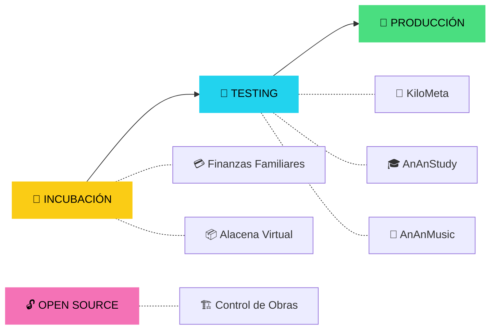

<!-- AnAnApps · Official Profile README · Propuesta A Aurora Violeta -->

  
  
  
  

  <a href="#-quiénes-somos"><b>Quiénes somos</b></a> •
  <a href="#-mapa-de-fases"><b>Mapa de fases</b></a> •
  <a href="#-proyectos"><b>Proyectos</b></a> •
  <a href="#-herramientas"><b>Herramientas</b></a> •
  <a href="#-actividad"><b>Actividad</b></a> •
  <a href="#-contacto"><b>Contacto</b></a>

---

## 🛰️ Quiénes somos

**AnAnApps** es un estudio independiente de desarrollo de software con base en Zipaquirá, Colombia 🇨🇴. Creamos productos digitales para **Android nativo, multiplataforma (KMP), Web PWA y Windows**.

Cada producto avanza por un ciclo de fases controladas: **Incubación → Testing → Producción**, con revisión de calidad en cada paso.

<b>⚙️ Nuestra forma de trabajar</b>

 

| Principio | En la práctica |
|---|---|
| 🎯 **Propósito** | Resolver problemas reales y concretos |
| 🧱 **Ingeniería** | Clean Architecture, fuente única de verdad (SSOT), tipado estricto |
| 🎨 **Experiencia** | Interfaces claras, consistentes y pensadas para móvil |
| ✅ **Calidad** | Cero datos simulados: cada pantalla conectada a funcionalidad real |
| 🔐 **Seguridad** | Cero secretos en el código, reglas Zero-Trust en la nube |

---

## 🗺️ Mapa de fases

| Proyecto | Fase | Plataforma | Repositorio |
|---|---|---|---|
| 🚗 **KiloMeta** |  | Android nativo | 🔒 Privado |
| 🎓 **AnAnStudy** |  | Web PWA | 🔒 Privado |
| 🎵 **AnAnMusic** |  | Android nativo | 🔒 Privado |
| 💳 **Finanzas Familiares** |  | Android + Windows | ⏳ Próximamente |
| 📦 **Alacena Virtual** |  | Android nativo | 🌐 [Público](https://github.com/ananapps799617/alacena-virtual-android) |
| 🏗️ **Control de Obras** |  | Web PWA | 🌐 [Público · MIT](https://github.com/ananapps799617/control-de-obras) |

---

## 🧭 Proyectos

> 👇 Haz clic en cada proyecto para ver su ficha técnica.

<b>🚗 KiloMeta</b> · Gestión operativa y financiera para conductores

 

  

Aplicación nativa para socios conductores: turnos, recorridos y finanzas en un solo lugar.

- **Stack:** Jetpack Compose · Clean Architecture · Hilt · Room (SSOT) · OSMDroid · Firestore · OTA In-App
- **Doble bolsillo:** balance separado por plataforma (Uber, DiDi, inDrive) en pesos colombianos
- **Telemetría:** odómetro inteligente, turnos y control real de combustible
- **Resiliencia:** sincronización bidireccional con protección anti-registros fantasma

<b>🎓 AnAnStudy</b> · Aprendizaje acelerado con IA

 

  

Aplicación web instalable para estudiar mejor y recordar más.

- **Stack:** React 18 · TypeScript · Vite · Groq AI · Firestore · Discord Webhooks
- **Repetición espaciada:** algoritmo SM-2 para memoria a largo plazo
- **Tutor IA:** generación de flashcards y explicaciones contextuales
- **Offline:** funciona sin conexión e instalable en cualquier dispositivo

<b>🎵 AnAnMusic</b> · Música en Android

 

  

Aplicación musical nativa para Android, actualmente en fase de pruebas.

- **Plataforma:** Android nativo
- **Estado:** en pruebas internas · más detalles próximamente

<b>💳 Finanzas Familiares</b> · Presupuesto del hogar en Android y Windows

 

  

Un solo núcleo de código ejecutándose como `.apk` en Android y `.exe` en Windows.

- **Stack:** Kotlin Multiplatform · Compose Multiplatform · Room KMP · Material 3
- **Funciones:** ingresos, gastos, categorías y metas de ahorro

<b>📦 Alacena Virtual</b> · Inventario doméstico inteligente

 

  

Organiza la despensa del hogar y evita desperdicios.

- **Stack:** Kotlin · Jetpack Compose · Room · Firebase
- **Funciones:** inventario, alertas de vencimiento y consumo

👉 [**Ver repositorio**](https://github.com/ananapps799617/alacena-virtual-android)

<b>🏗️ Control de Obras</b> · Open Source · Gestión de obras y diseño 3D

 

  

Madurado en 92 órdenes de desarrollo y liberado para que cualquiera lo use, lo bifurque o lo continúe.

- **Stack:** React 18 · TypeScript 5 · Vite · Three.js · Tailwind · Firestore
- **Funciones:** presupuestos, compras, abonos, balance y diseñador 3D paramétrico con optimización de corte

👉 [**Ver repositorio**](https://github.com/ananapps799617/control-de-obras)

---

## 🧰 Herramientas

| Herramienta | Función |
|---|---|
| 📸 **Capturador de Evidencia Visual** | Capturas duales (móvil + escritorio) para auditoría de interfaz |
| ☁️ **Sync Drive API** | Publicación OTA de APKs y respaldo documental en Google Drive |
| 🛡️ **Git & GitHub Manager** | Control de versiones, ramas y despliegues |

---

## 🛠️ Arsenal tecnológico

  

---

## 📈 Actividad

  
  
   
  
   
  

---

## 📡 Contacto

**¿Tienes una idea o propuesta de colaboración?**

📍 Zipaquirá, Colombia · 🧬 **Ecosistema AnAnApps v2.0**

<em>Construido con intención. Diseñado para evolucionar.</em>

